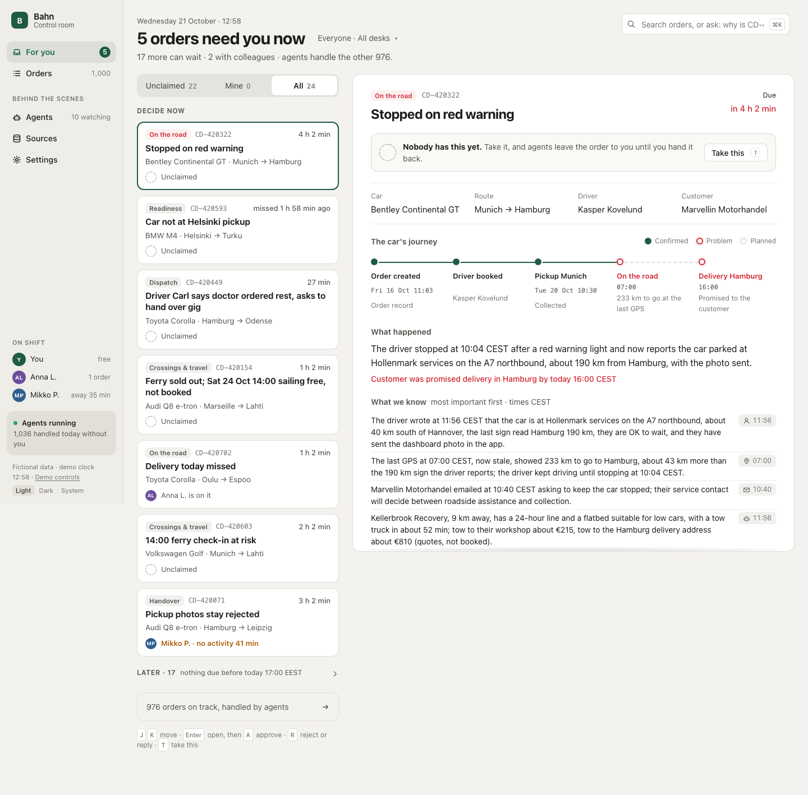
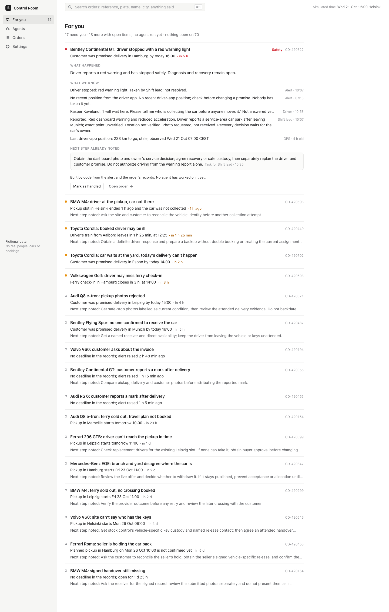
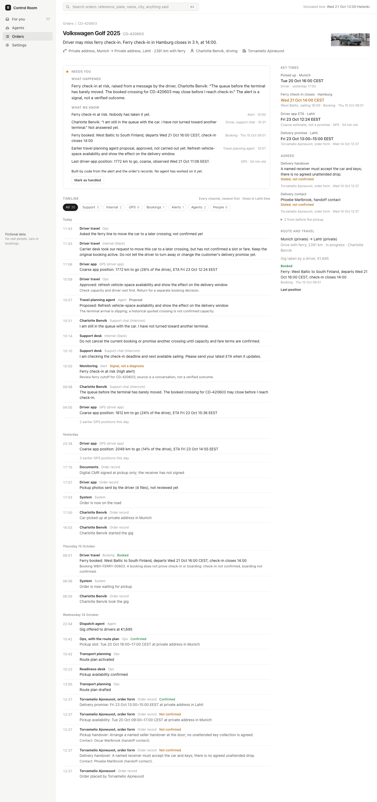
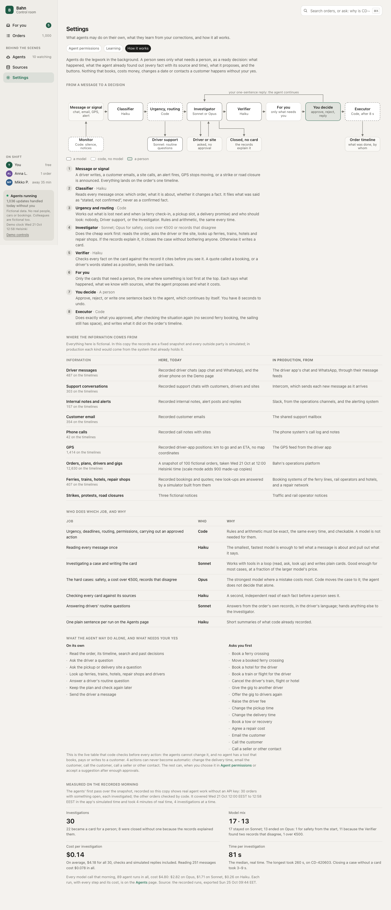

# The Car Delivery Control Room

A control room where agents and people deliver used cars together, built for Bahn's challenge at the
Prompt Operations Hackathon (24 to 25 October 2026). Agents read every message, investigate every order
with a problem and put only what needs a person in front of one, as a ready decision with each fact's
source and time and a button that says exactly what happens. Nothing that books, costs money, changes a
date or contacts a customer happens without a person's yes, and that rule is enforced in code, not in a
prompt.

| For you: what needs a person, most urgent first | One card opened: facts with sources, what approving does |
|---|---|
|  |  |
| **An order: the case, key times and one timeline** | **How it works: the flow, for an operations manager** |
|  |  |

Every page in light and dark is in [`screens/`](screens/); short videos of the scenarios are in
[`demo-footage/`](demo-footage/SHOTLIST.md). All data is fictional: no real people, cars or bookings.

## Run it from a fresh clone

You need Node.js 24 or newer and Docker. An Anthropic API key is optional.

```sh
cd starter
cp .env.example .env        # optional: add ANTHROPIC_API_KEY=... to run the agents live
npm ci
docker compose up -d --wait
npm run db:push
npm run setup               # dataset, attachments, timeline, alert cards, disruption feed, recorded agent runs
npm run dev -- -p 3001
```

Open http://localhost:3001 (any port works; the screenshot and footage scripts use 3001). Start on
**For you** (what needs you now, then later; "I'll handle this" takes an order over, and no agent acts on it until
you hand it back). **Agents** shows what every agent did and is doing, **Orders** has every order with who has it,
**Sources** shows every channel that feeds the order timelines, **Settings** holds what agents may do on their own,
what they learned from your corrections and **How it works**.
**Demo controls** (foot of the left rail) moves the simulated clock, plays the scenarios and switches
scale mode.

**Without an API key** the app shows the agent runs recorded in `fixtures/agent-runs.json` (the top bar
says so). Approving still works: the Executor is code. "Replay recorded run" on the Demo page plays a
recorded live run of a scenario at its real speed. **With a key** (`npm run api:check`) the agents run
live: "Play live", "Ask the agents" in the search box, replies to an agent, and the Monitor's rules.

**Scale mode**: `npm run seed:scale` (or the Demo page) adds 900 made-up quiet orders copied from the
dataset's quiet orders, so the app runs with 1,000; `npm run seed:scale -- --off` removes them.

If port 5438 or 9009 is taken, change it in `starter/compose.yaml` and the matching line of
`starter/.env`.

## Tests and evals

```sh
npm test                     # 46 unit tests (urgency, routing, policies, taking an order over, the undo window) + the evals on recorded runs
npm run evals                # the eval cases and prompt-injection checks: recorded without a key, live with one
npm run evals -- --live      # play every case on the live models first, then check (about $2)
npm run eval:injection       # the prompt-injection test alone; its result shows on Settings → Learning
npm run typecheck && npm run smoke   # types, and For you, all order pages and search against a running app
```

`npm run fixtures:load` brings back the recorded morning after any live run.

## How it is built

- **One case file per order** (`lib/case.ts`): the dataset's orders, messages, alerts, events and
  bookings compiled into one timeline, key times and facts, each with its source and time. The screens,
  the agents and the evals all read it.
- **Code decides what is urgent, who looks, and what may happen**: urgency and deadlines
  (`lib/urgency.ts`), routing (`lib/router.ts`), the Monitor's rules for disruption notices, silent cars
  and unanswered questions (`lib/monitor.ts`), quiet checks (`lib/quiet-check.ts`), and the policies
  table (`lib/policies.ts`) that every proposal and every execution is checked against. Customer contact
  and a promised delivery date can never be automatic.
- **Models do the reading and the investigating** (`lib/agents/`, model ids only in `lib/models.ts`):
  the Classifier (Haiku) reads every message; the Investigator (Sonnet, Opus for safety, costs over
  €500 or records that disagree) works with read, ask and look-up tools and writes a card; the Verifier
  (Haiku) checks every fact against the record it cites; Driver support (Sonnet) answers routine driver
  questions; the Narrator (Haiku) writes one line per run. No agent has a tool that books, pays or
  contacts a customer.
- **A person decides, code carries it out**: For you sorts cards by what is lost first; an approval
  waits 8 seconds for Undo; then the Executor (`lib/executor.ts`) books, messages or hands the call to
  the person, each step checked against the policies again, and writes what it did on the order.
- **Next.js, Postgres, a simulated clock**: Next.js App Router with server components, Postgres through
  Drizzle, a local S3 store for attachments, live updates over server-sent events, and a simulated
  clock (`lib/clock.ts`) that starts at the end of the recorded morning.

## Where to look

- [`PROCESS-LOG.md`](PROCESS-LOG.md): how it was built, phase by phase, with what went wrong and what
  was changed, including two independent UX reviews.
- [`traces/`](traces/): one JSON trace per recorded agent run, every step and tool call.
- [`fixtures/`](fixtures/): the recorded runs, the scenario recordings and the backfill report.
- [`SPEC.md`](SPEC.md): what is built; `PARTICIPANT-BRIEF.md`, `OPERATIONS-CONTEXT.md` and
  [`dataset/`](dataset/) for the challenge and its data.

## The challenge packet

This repository started as Bahn's challenge packet, and that material is still here:
`PARTICIPANT-BRIEF.md` (the challenge), `OPERATIONS-CONTEXT.md` (how car delivery work goes at Bahn),
`dataset/` (100 made-up orders and everything around them; `dataset/SCHEMA.md` explains every field),
`attachments/` (made-up documents and photos), `mockups/` (screenshots of the original starter, before
this work) and `check_packet.py` (checks the data is complete: `python3 check_packet.py`). Everything
in it is made up: no real people, cars, companies or messages.
